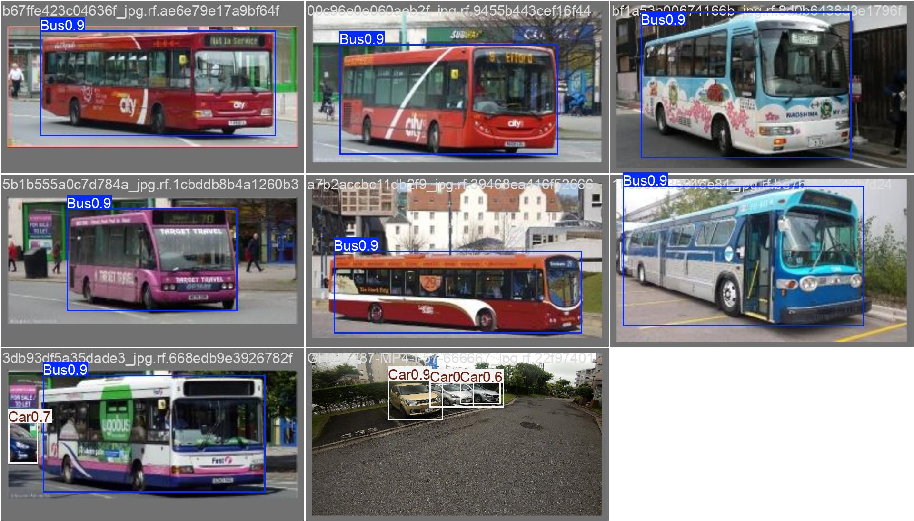
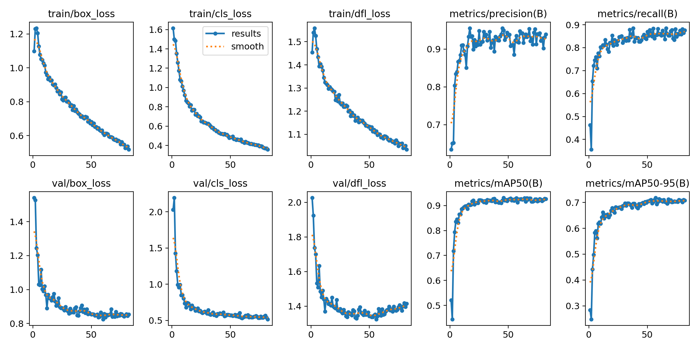
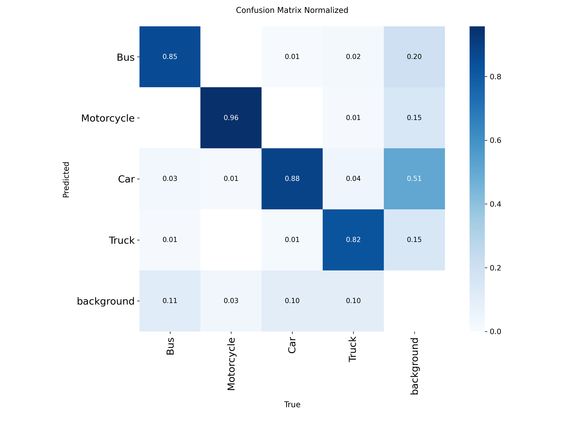

# Vehicle Detection with YOLOv8s

Detects and counts 4 vehicle classes (**Bus, Motorcycle, Car, Truck**) in traffic images.
YOLOv8s was fine-tuned on a cleaned Roboflow dataset and is served through a small desktop demo app.

> Team project (6 members) for the *Introduction to Artificial Intelligence* course,
> University of Science, VNU-HCM, 2026. Code comments are in Vietnamese.



## Results

Validation set: **324 images, 466 objects**. Model: YOLOv8s (11.1M params), 640×640 input.

| Class      | Precision | Recall | mAP@0.5 | mAP@0.5:0.95 |
|------------|:---------:|:------:|:-------:|:------------:|
| **All**    | **93.6**  | **85.4** | **93.0** | **71.7** |
| Bus        | 92.7      | 85.5   | 93.1    | 81.1         |
| Motorcycle | 97.8      | 93.5   | 96.7    | 61.6         |
| Car        | 90.8      | 80.3   | 90.4    | 66.7         |
| Truck      | 93.1      | 82.4   | 91.6    | 77.4         |

**Observations**

- **mAP@0.5 vs mAP@0.5:0.95 gap (93.0 → 71.7).** The model finds vehicles reliably, but its
  boxes are not always tight. Stricter IoU thresholds expose that.
- **Motorcycles show the largest gap (96.7 → 61.6).** They are small objects, so a few pixels
  of box error cost a large share of IoU.
- **Longer training did not help.** A full 150-epoch run (notebook 03, 2.4 h on 2×T4) reached
  the same validation mAP as an early-stopping run (`patience=25`, best epoch 57, stopped at 82).
  The curves below come from the early-stopping run.

| Training curves | Normalized confusion matrix |
|:---:|:---:|
|  |  |

## Data pipeline: avoiding train/test leakage

Source: Roboflow export with 1,675 images in COCO format ([dataset](#dataset)).

1. **COCO → YOLO conversion:** bounding boxes are converted to normalized `cx cy w h`, and one
   empty category is dropped.
2. **Exact-duplicate removal:** images are grouped by a 64-bit average hash (aHash). This
   removed 65 duplicates.
3. **Group-aware split, 70 / 20 / 10:** Roboflow stores several augmented copies of the same
   source photo (same UUID, different `.rf.` suffix). A random *file-level* split would leave
   about 75 source photos on both sides of the train/test boundary. The split is therefore made
   on the **source-image UUID**, so every copy of a photo stays in one split.
4. **Augmentation on the training split only:** two photometric transforms per image
   (brightness, contrast, noise, blur, JPEG compression…) keep box coordinates unchanged.
   Validation and test stay 100% original.

| Split | Images | Objects |
|-------|-------:|--------:|
| Train (incl. augmented) | 3,357 | 4,869 |
| Val   | 324 | 466 |
| Test  | 167 | 277 |

## Demo app

`app/vehicle_detection_app.py` is a CustomTkinter GUI that draws boxes and counts vehicles per class.

- It runs the model **once** at a low confidence (0.05) and caches every candidate. Moving the
  threshold slider then only filters the cache, so the model does not run again.
- It **suggests a threshold for each image** by finding the largest gap in the sorted
  confidence scores, which separates real detections from noise.
- It **adapts the inference size**: about 640 for normal images, up to 1280 for
  high-resolution images. Upscaling small images hurt detection in our tests.

```bash
pip install -r requirements.txt
python app/vehicle_detection_app.py   # put best.pt next to the app, or pick it in the UI
```

## Repository layout

```
notebooks/
  01_data_pipeline.ipynb        COCO→YOLO, dedup, group-aware split, train-only augmentation
  02_verify_dataset.ipynb       label/image counts per split, class balance, box visualisation
  03_train_yolov8s_kaggle.ipynb training + validation on Kaggle (2×T4)
scripts/
  phan_loai_anh_trung.py        export removed duplicates for inspection
  tach_anh_augment_theo_tap.py  list Roboflow-augmented copies per split
app/
  vehicle_detection_app.py      desktop demo
results/                        curves, confusion matrix, run config (args.yaml), metrics per epoch
```

Model weights (`best.pt`, 22.5 MB) and the dataset are not stored in this repository.

## Limitations and next steps

- **The test split (167 images) has not been evaluated yet.** All numbers above come from the
  validation set, which was also used for checkpoint selection, so they are slightly optimistic.
- aHash only catches exact or near-exact duplicates. Visually similar frames can still sit in
  different splits.
- Next steps: report test-set metrics and per-class error analysis for small motorcycles.

## Dataset

[Vehicles (Roboflow Universe)](https://universe.roboflow.com/nguyen-nam-hhskv/vehicles-k83q3-qf9zp),
licensed under **CC BY 4.0**. The images in `results/` are derived from this dataset.
